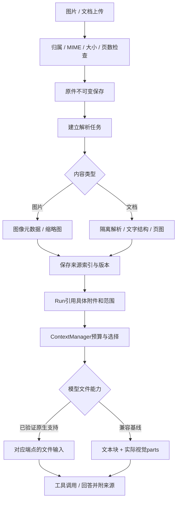

# AgentDock 多模态输入与文档理解设计

版本：v1.1评审稿｜2026-10-28。依据：用户明确使用多模态模型、OpenAI兼容接入，并要求图片和文档能被解析理解。格式范围、配额及处理库为D建议，尚未实施。

配套：[主技术设计](AgentDock-技术设计-v1.1.md)、[上下文与记忆](AgentDock-上下文与记忆设计-v1.1.md)、[文件存储](AgentDock-文件存储与并发设计-v1.1.md)。

## 1. 能力目标

- 图片不只作为下载附件：模型实际接收图像内容，能阅读截图、图表、照片中的信息。
- 文档不只提取文件名：按格式提取文字、段落、表格、页图及来源，必要时结合视觉理解。
- 扫描页可通过页图和可选OCR处理，不声称所有PDF都有可提取文字。
- 后续追问可以重新读取原件或某页／某区域，不能只有一份不可回溯摘要。
- 模型理解与精确计算分开：统计聚合、公式和数据变换交Sandbox代码验证，模型负责解释。

语音、视频、图片生成不因“多模态模型”自动加入首版。

## 2. OpenAI兼容的能力配置

用户指定兼容方式，尚未给出具体供应商和endpoint。设计先提供Chat Completions兼容适配，Responses按明确能力支持；不是让用户更换品牌。

ModelCapabilities建议包含：api_mode、supports_tools、supports_image_parts、supports_pdf_file_parts、supports_responses、supports_files_upload、supports_native_compaction、context_window、max_input_tokens、max_output_tokens、max_images、image_detail_modes、token_estimator。

- Chat Completions：文字用text，图片用image_url content part，内部可以按支持情况构造data URL；使用消息数组和工具调用。
- Responses：使用input_text／input_image／input_file等对应结构，不把Chat请求原样发给Responses。
- 原生文件输入：仅在该服务和所选模型验证支持时使用。PDF与非PDF能力分开配置，不能根据“OpenAI兼容”自动开启。
- 如果供应商未支持Files API，不强制先上传到该供应商；可用本地解析后构造文字与图像parts。
- native compaction、文件上传、图片输入和tool calling是不同能力，应分别做小验证。

官方OpenAI的文件输入能力随端点不同，文档提取也不总包含嵌入图表；这些事实是兼容核验依据，不是第三方服务的能力保证。[OpenAI文件输入](https://developers.openai.com/api/docs/guides/file-inputs)

## 3. 首版文件范围建议

| 输入 | 默认处理 | 不隐瞒的限制 |
|---|---|---|
| PNG/JPEG/WebP | 检查实际类型、尺寸／方向，生成安全缩略图；原图或选定分辨率交视觉模型 | 小字、复杂图表仍可能识别不准，需要原图回读 |
| PDF文字版 | 按页提取文字与结构索引；关键图表／布局页可渲染为图像 | 文字提取顺序和表格结构可能不完整 |
| 扫描／混合PDF | 逐页判断文字是否可用，扫描页渲染图像；必要时OCR辅助 | OCR失败或低置信度标记，不当确定事实 |
| DOCX | 标题／段落／表格／嵌入图片提取，保留段落和表格编号 | 精确分页取决于渲染，不能编造Word页码 |
| PPTX | 幻灯片文字、备注和图片，保留slide编号；需要整体布局时可转换PDF／页图 | 整页渲染需受控转换器，不假定镜像已有 |
| XLSX/CSV | 工作表、表头、类型、样本行、公式及可用缓存值；精确计算由脚本完成 | 不自动执行宏，不把公式缓存当实时重算 |
| TXT/MD/JSON等 | 编码检查、分块、行／路径来源 | 不执行HTML/脚本，不把文本指令变系统规则 |

旧DOC/XLS/PPT、加密／损坏文件、宏、ZIP目录炸弹等初版拒绝或提示管理员启用转换；不能宣称支持任意文档。图片像素、PDF页数和展开大小单独限额，不能只看文件字节。

通用附件还要区分“原件可安全传递”与“内置解析器能理解”。获准的其他二进制格式可以作为opaque FileRef交给匹配的Skill／运行工具，不能因没有内置文档解析器就把整个任务永久阻塞；也不能把opaque标成已理解。用户的STEP样本属于此类，由隔离几何工具生成可读数据／图像后进入模型。上传类型和安全政策仍生效，损坏、恶意或未获准类型不借此绕过校验。

候选解析器：Pillow、PyMuPDF或pypdf、python-docx、openpyxl、python-pptx；渲染和OCR根据镜像与许可证选择。PyMuPDF等许可需在实施选型时核查；不因写进候选就安装。复杂转换建议隔离环境，不在Windows执行文档宏或附带代码。

## 4. 数据与状态

原件在files集合＋StorageProvider；新增document_jobs、document_versions、document_segments，必要时派生files表示页图／提取文本／缩略图。segments记录source_file_id、source_hash、parser_version、page/slide/sheet/paragraph、bbox?、text_ref、image_ref、confidence、warnings和权限归属。

| 状态 | 语义 |
|---|---|
| uploaded/validating | 原件已收到，尚未可安全解析 |
| parsing | 正在解析结构或渲染 |
| ready | 已有可用索引与内容，不表示模型已读完全部内容 |
| partial | 仅部分页／结构成功，必须展示覆盖范围 |
| failed/unsupported | 失败或不支持，有明确原因 |
| cancelled/expired | 处理停止，不再继续新工作 |

“需视觉识别”作为段／页的处理标志，不假装已完成OCR。真正视觉解释在Run中按需调用模型，避免上传任意附件就自动消耗模型费用。元数据解析和缩略图可以先完成，不代表整份文件已被理解。

原文件files.ready表示字节已保存并可授权读取；document_jobs的ready／unsupported表示内置解释能力，二者不混用。仅当任务明确依赖某项内置解析时，相关Job未就绪才作为queued依赖；若批准的Skill／工具负责该opaque格式解析，可从原件ready进入相应流程并如实显示“由工具解析”，不等待不存在的内置解析器。

ready的准入只要求所需受控文字／页图及来源索引可读取，needs_vision不阻塞；另存模型实际已读范围。解析任务幂等键包含owner、file_id、source_hash、parser_revision、规范化页范围及影响结果的渲染／提取选项。补充其他页产生新的范围Job，已完成segment以source_version＋页／区域＋transform_hash唯一复用，避免不同页误判重复，也避免同页重复处理。

## 5. 上传到模型的处理流程

原件验证通过后可提交任务，但未ready时Run保持queued并标dependency_pending，不能领取执行槽。解析工作使用单独受限内部任务配额，不能因为Run等待解析就占满所有槽导致依赖无法完成。MVP解析槽建议1、Run槽2；账号容量和总资源共同受限。也可由UI等待解析后再提交，默认推荐后者。

解析Job归用户／对话／文件，不是无人归属的后台任务；其Sandbox独立于Agent Run，按Job创建清理，不跨用户复用可写环境。解析器是受信程序处理不可信文件，仍受网络／资源限制。转换需预制镜像，禁止从上传文档提取命令在主机执行。

Run模型首轮收到附件概览＋与目标相关的文字／图像。仅提供file_id不构成“已理解”；对用户直接询问某张图片，至少将所问图片的实际视觉内容放入当前调用。长文档通过目录／索引挑页、分批读取，不承诺一轮看完整份。

## 6. 图像与文件请求组装

持久消息使用内部MediaRef：file_id、document_version、page/range、transform_revision、hash。模型适配器在调用前重新鉴权，从StorageProvider读取受限字节，构造端点需要的base64／文件parts。

不把base64、供应商Token或短时签名URL长久写入Mongo消息／检查点；内部引用可重建。外部URL若使用必须是服务端产生的授权短时地址，不能模型随意指定任意URL触发下载。原始附件发送给配置的外部模型属于数据出站，UI给出明确说明，遵循管理员策略。

图像裁剪／缩放保留原件和转换元数据；低分辨率预览不能被说成高保真完整识别。模型需要更清楚的区域时调用受控read_document_pages或read_image_region，返回有界视觉输入而非只给一段“这里有图片”的文本。

工具返回值不盲目塞图片到任意role：兼容Chat Completions的tool消息先以文本配对tool_call_id并给出MediaRef；若该端点不支持tool-role图像，由适配器在完整工具配对后追加明确标记为“工具取回的视觉数据”的user-role多模态观察消息。它不是新的人类指示，更不授予权限。内部保留真实来源与role转换记录，内容仍按不可信数据处理；Responses按其支持的结构单独组装，不强行复用相同payload。实际role／content支持需端点验证。

## 7. 与上下文压缩及记忆的关系

上下文预算包含视觉token、文档页图、文本、工具schema和输出预留。不同兼容模型计费／分辨率规则不同，使用能力配置和实际usage校准，不能只对文字计token就保证不会超窗。

历史多模态消息可以压缩成“已确认事实＋不确定项＋来源file/page/bbox引用”；原图／原文仍保存，需要时重新读取。摘要不能抹掉图片中尚未观察的细节，也不能捏造页面事实。压缩时保留用户当前问题对应的原始视觉内容；不能只留OCR导致图表、位置和颜色等信息丢失。

同一文档更新形成新file/version；上下文snapshot固定具体版本、页范围和hash。修改版本后旧摘要必须标来源旧版，不能混用为当前内容。

## 8. 限额、失败与界面

继承单文件20MiB／Run输入100MiB建议，另外建议：单图最大20MP、单文档最多50页自动解析、单模型调用最多6张图／页图、页图长边约1600～2000像素并受总请求大小限制。均为D初值，依模型可配置；超限提示选择范围／分批，不静默截去后半文件。

解析结果partial时列出失败页和覆盖范围，由用户确认基于部分内容继续或重新提供文件；问答有来源标记。损坏／密码保护／转换缺依赖／模型不支持输入等错误分别报告，不能一概让模型修脚本。

UI显示上传、校验、解析、可用／部分失败状态，图片缩略图、页数、选定范围及来源定位。模型接入测试分别验证文字、工具、图片；PDF和其他文件能力单独验证，不拿文字测试成功当多模态接入成功。

## 9. 验收与技术核验

- 上传截图询问局部文本，确认请求实际含图像；原件hash可追溯。
- 文字PDF、扫描PDF、混合页PDF均能明确处理范围，回答附页引用。
- Word无确定分页时引用段落／表格，不编造页码；表格公式和值区分。
- 兼容端点不接受PDF时退回提取文字＋页图，不谎报原生支持。
- 大图／超长文档触发预算控制，压缩后仍能按来源回读相关区域。
- 前轮多模态事实被摘要后，后续追问可回查原文件，不跨用户获取。
- 解析崩溃／超时／资源超限有幂等状态和清理记录，取消不会重复解析计费。
- Mongo文档不保存无限base64或页内容数组，派生大文件走StorageProvider。

目前没有读取用户真实图片／文档，没有调用已配置模型；所有支持矩阵须以实际模型和镜像验证后标V。

## 10. 核对来源

- [OpenAI Images and Vision](https://developers.openai.com/api/docs/guides/images-vision?api-mode=chat)：核对实际视觉输入的请求结构。
- [OpenAI File Inputs](https://developers.openai.com/api/docs/guides/file-inputs)：核对端点和文件类型支持边界。

以上是协议参考，不代表第三方兼容服务具备OpenAI官方全部功能。本设计不绑定特定多模态模型品牌。
