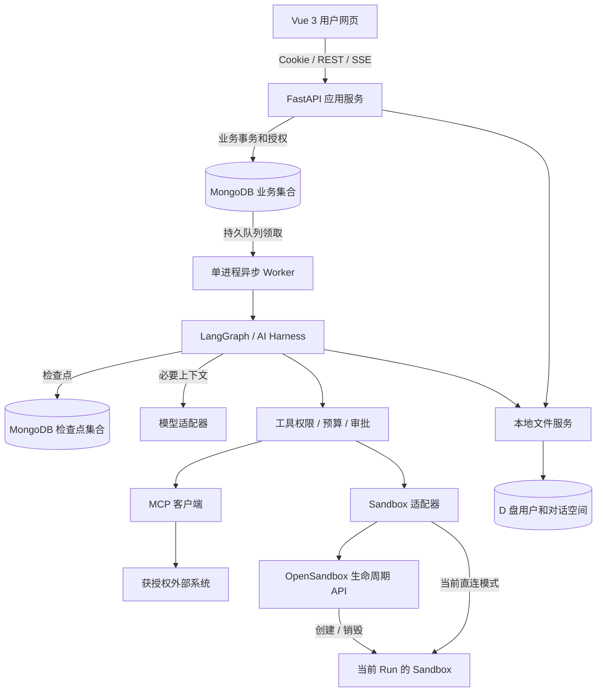
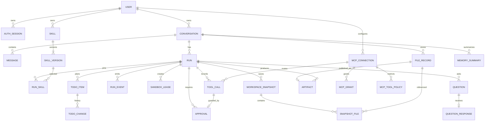
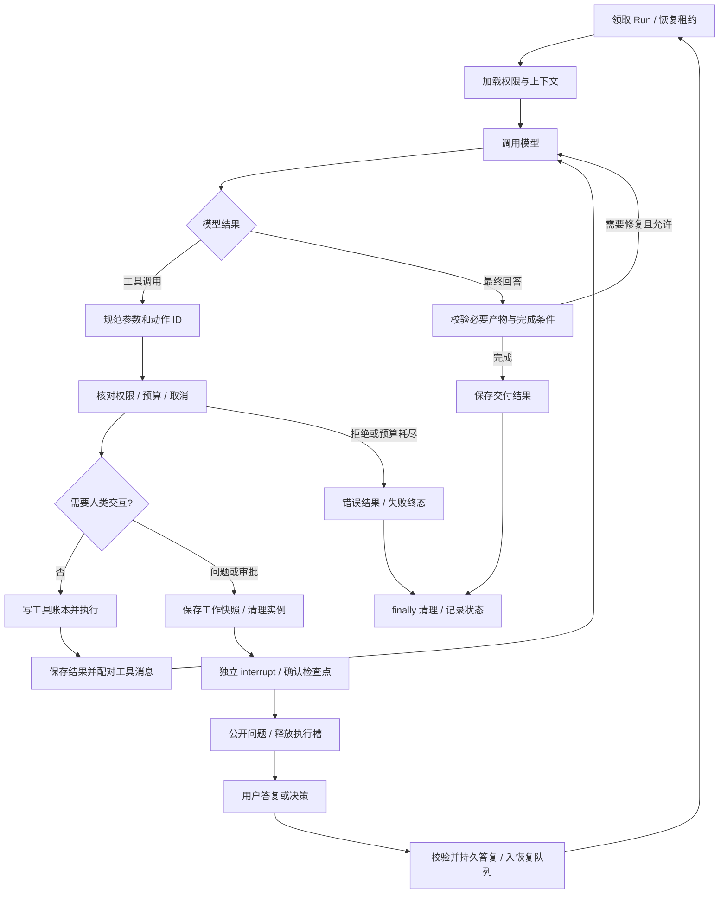
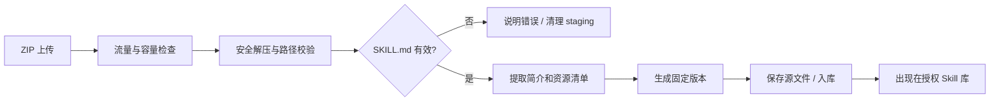
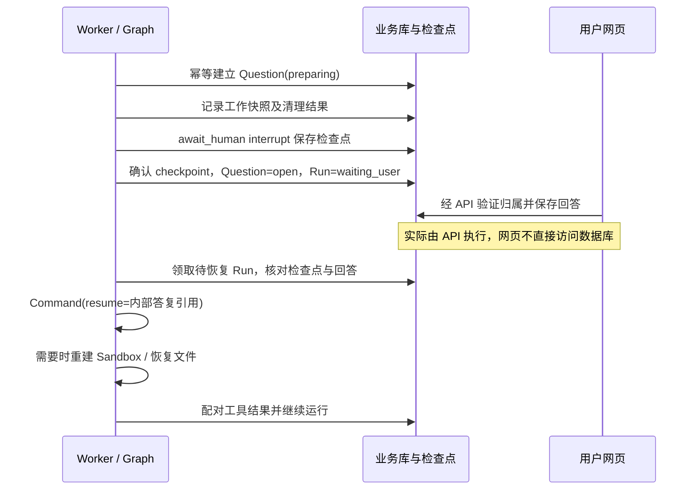
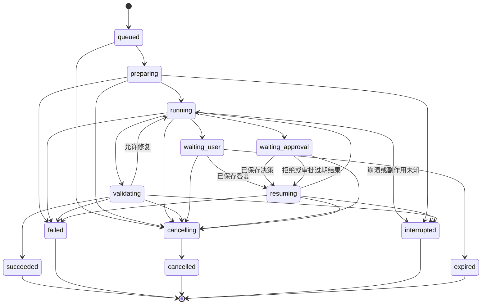

# AgentDock 技术设计

版本：v1.1 设计基线（分阶段实施计划中）  
日期：2026-10-29（Asia/Shanghai）  
工程：`D:\Projects\AgentDock`  
依据：[需求基线](AgentDock-需求与功能基线-v1.0.md)、[功能简版](AgentDock-功能需求简版-v1.0.md)及根目录 `AGENTS.md`。

> 本版依据用户新指示修订：前端 Vue 3 + JavaScript，UI 采用用户推荐的 Element Plus，数据库 MongoDB；补充长会话上下文管理及多模态输入。替代 v1.0 的对应技术建议，旧版仅留作历史。未安装新依赖、部署数据库或开发产品；其他新增机制与参数仍为评审建议。

## 1. 设计摘要与阅读入口

**主方案：模块化单体，独立 Web API 与执行进程；MongoDB 承载业务数据、持久任务和 LangGraph 检查点，文件内容通过可替换存储接口管理。**

- 前端：Vue 3 + JavaScript + Vite + Element Plus；不引入 TypeScript 业务源码。
- 后端：Python 3.12 + FastAPI + Pydantic；LangGraph 控制 Agent 循环。
- 存储：MongoDB 8.x 副本集 + PyMongo；本地文件先落 D 盘用户空间，预留 S3 兼容对象存储适配。
- 任务：一个独立 Python Worker，初始两个异步执行槽；数据库持久排队，不引入 Redis/Celery。
- 交互：REST 写操作 + SSE 事件订阅，Cookie 会话认证。
- 扩展：业务服务不依赖网页；模型、MCP、Sandbox、文件存储是明确的适配边界。
- 安全：服务端鉴权，Question Human 与副作用审批分离，执行有界，凭据不进入模型或 Sandbox。

配套设计：

1. [UI 与交互设计](AgentDock-UI与交互设计-v1.1.md)：页面、线框、状态和操作反馈。
2. [执行与恢复专题](AgentDock-执行与恢复设计-v1.1.md)：并发、账本、检查点、问答恢复的详细规则。
3. [上下文与记忆](AgentDock-上下文与记忆设计-v1.1.md)：长会话、压缩、来源与预算。
4. [文件存储与并发](AgentDock-文件存储与并发设计-v1.1.md)：本地到上线的边界、不可变文件及锁。
5. [多模态输入](AgentDock-多模态输入设计-v1.1.md)：图片、文档及OpenAI兼容协议。
6. [交互式组件架构图](design/architecture-v1.1/agentdock-architecture.html)：建议架构，不代表已实现。
7. [通用Skill宿主能力](AgentDock-通用Skill宿主能力设计-v1.1.md)：套件依赖、运行环境、OAuth、资源、外部视图、范围授权与长期资料。
8. [实际Skill适配评估](AgentDock-Skill适配评估与结论.md)：对`D:/Work/skills`的静态证据、补充前后差异及实际接入条件。

本文是主设计。配套文档若有歧义，以本文明确约定为准；实施前修订冲突，不自行混用两个方案。

## 2. 约束、目标与方案比较

2026-10-29用户已确认：首轮以实际Skill套件的一个代表性完整工作流验收，不要求穷尽复杂CAD场景；显式任务范围内可连续执行，删除／覆盖／公开发布／正式归档／范围扩展独立确认；首版采用单机多用户、MongoDB副本集和本地持久文件，保留存储替换接口。对应需求U24～U26。此确认允许进入实施计划，不表示产品已实现，也不将全部D类配额升级为用户决定。

### 2.1 不变的约束

Windows D 盘开发，不在 Ubuntu 编辑应用；第一版即多用户网页；支持通用 Skill、用户 MCP、多轮追加、Question Human、Todo、代码执行及下载。用户会把业务和做法接入已有系统，代码清楚、可迁移，中文注释目标 15%，DOM 标签不要求注释。

### 2.2 架构方案与已确认选型

| 方案 | 内容 | 收益 | 代价／判断 |
|---|---|---|---|
| A：API内执行全部任务 | MongoDB业务存储、API内启动Agent | 少一个进程 | API重启直接影响长任务；不推荐 |
| B：模块化单体 + 独立 Worker + MongoDB | 一份后端工程、两个入口、统一文档数据库 | 多用户排队和恢复边界明确、业务可迁移 | 需副本集事务和明确CAS；**主方案** |
| C：微服务 + Redis/Celery + MongoDB | 多服务、多队列及分布式执行 | 可扩展到更多节点 | 超过当前MVP规模，暂不采用 |

用户已明确选择Vue 3＋JavaScript和MongoDB，本版采纳Element Plus偏好。B的进程划分、驱动版本和配额仍为建议。MongoDB调整不是替换连接串：原SQL行锁、外键、SKIP LOCKED及ORM迁移方案全部撤销，改用文档建模、唯一索引、条件更新和必要事务。

### 2.3 MVP 范围边界

只做单机部署、一个 API 实例和一个 Worker 进程。多用户不等于多租户组织平台，不引入计费、SSO、多 Agent、向量库、插件市场或自动后台长期任务。暂不把可迁移业务打包成通用 SDK。

## 3. 技术栈与框架

| 层次 | 建议基线 | 用途与选择原因 |
|---|---|---|
| Python | 3.12.x | 选择兼容成熟的产品基线；已实测的 3.14.7 仅为临时环境 |
| Python 包管理 | `pyproject.toml` + uv 锁定 | 固定可复现依赖；必要时导出 requirements，不维护两份独立真相 |
| Web | FastAPI + Uvicorn | 类型化 API、异步 IO、OpenAPI；API 不承担长期任务执行 |
| 校验／配置 | Pydantic 2 + pydantic-settings | 请求、领域 DTO、环境变量和配置校验 |
| Agent | LangGraph 1.x | 显式节点、循环、检查点及人工中断；不用不可见的大型自主代理框架 |
| 模型接口 | OpenAI兼容适配器（LangChain Core／langchain-openai） | 用户已明确协议；Chat Completions基线，视觉／文件／Responses能力分别验证，不绑模型品牌 |
| Sandbox | `opensandbox==1.2.0` 起步 | 延续已验证 SDK；执行镜像固定 `code-interpreter:v1.1.0`，升级独立验收 |
| MCP | 官方 Python MCP SDK 的兼容稳定版 | 使用协议客户端，避免手写 JSON-RPC；准确版本在兼容测试后锁定 |
| 数据库 | MongoDB 8.x 副本集 | BSON文档、唯一索引、条件更新、多文档事务、持久队列及检查点 |
| 数据访问／迁移 | PyMongo 4.x Async API + 仓储 + 版本化迁移脚本 | 不使用SQLAlchemy/Alembic，不强加ODM；字段校验、索引和schema_version显式管理 |
| 检查点 | langgraph-checkpoint-mongodb / MongoDBSaver | 使用现有集成，业务与图集合分开；准确版本、异步封装和取消行为待验证 |
| 会话／密码／密文 | 随机不透明会话、Argon2id、cryptography AEAD | 不把 Token 放 localStorage；凭据密文存库、密钥在部署环境 |
| 前端 | Vue 3 + JavaScript | SFC＋Composition API＋script setup，不使用lang=ts；JSDoc描述关键DTO和函数契约 |
| 构建 | Vite 稳定兼容版 + Node 22.12+／24 | 无 SSR 需求，避免 Next.js 同时引入第二套服务端业务 |
| UI | Element Plus 2.x + scoped CSS／少量主题变量 | 采纳用户偏好，复用表单、表格、抽屉、上传和通知，不造组件库 |
| 路由／服务端状态 | Vue Router 4 + TanStack Vue Query | API缓存、失效和重连；小型本地状态用composable，不默认引入Pinia |
| 请求与事件 | fetch + 原生 EventSource | 同源 Cookie，REST 命令、SSE 单向事件；不用 WebSocket 处理普通表单 |
| 前端包管理 | npm + lockfile | Windows 普及、额外工具少，选型可替换 |
| 测试／质量 | pytest、pytest-asyncio、httpx、Ruff；Vitest、Vue Test Utils、Playwright、ESLint | 单元、集成、组件与真实浏览器验收分层 |

除 OpenSandbox 验证组合外，以上不是已安装版本清单，也不声称是最新版。实施前在 Python 3.12／Windows 上解依赖并锁定补丁版本。Vite 的 Node 要求应按锁定版官方文档核验；当前官方入门页说明了兼容门槛。[Vite 文档](https://vite.dev/guide/)

业务数据使用PyMongo AsyncMongoClient；每个并发用例独立session，事务内不并行操作。官方已有MongoDBSaver用于LangGraph检查点；其异步方法与业务驱动客户端的实现不同，不假设可共用一个事务。[PyMongo Async](https://www.mongodb.com/docs/languages/python/pymongo-driver/current/reference/migration/)、[MongoDB LangGraph集成](https://www.mongodb.com/docs/atlas/ai-integrations/langgraph/)

## 4. 进程、部署与信任边界

### 4.1 进程安排

| 部件 | 位置 | 建议端口／边界 |
|---|---|---|
| 浏览器 | 当前 Windows 宿主机 | 不直接访问 Sandbox 管理接口 |
| 前端开发服务 | Windows | 5173，仅开发，代理 `/api` 到 8000 |
| API 进程 | Windows | 8000，默认只监听 loopback |
| Worker 进程 | Windows | 不开放 HTTP 端口，读取持久任务 |
| MongoDB | Docker Desktop独立副本集或用户已有实例 | 27017仅loopback；本地单节点副本集仅提供事务能力，不提供高可用 |
| OpenSandbox Server | 已有 WSL2／Docker 环境 | 当前 `localhost:8080`，保留已有配置 |
| Sandbox | Docker 独立实例 | Worker 通过已验证的映射端口访问；不向浏览器暴露 |
| LLM／MCP | 外部或管理员允许的位置 | 独立出站规则及凭据范围 |

构建后的前端由 FastAPI 静态提供，部署使用同源 API 与 Cookie，开发通过 Vite 代理保持相同行为。MVP 不新增 Nginx，不默认开放局域网或公网。

MongoDB建议使用独立持久卷；这是数据库自己的数据目录，不通过文件API开放。若要求物理数据也在D盘，实施时配置并验证Docker挂载；named volume可能位于Docker虚拟磁盘，需如实说明。多文档事务要求副本集／分片集群，不能直接使用standalone mongod。本机可单节点副本集，线上建议托管或规范副本集，不能把单节点当高可用。[MongoDB事务部署要求](https://www.mongodb.com/docs/v8.0/data-modeling/enforce-consistency/transactions/)

### 4.2 组件架构



图表示逻辑模块；Graph 与工具服务在 Worker 内运行，不是新建一组微服务。检查点与业务集合可在同一MongoDB服务，但客户端和提交过程独立，不天然原子。

### 4.3 模块边界

| 模块 | 核心职责 | 不负责 |
|---|---|---|
| identity | 当前用户、账号状态、会话 | 替模型猜测用户身份 |
| conversations | 消息顺序、对话活跃 Run、摘要 | 直接执行外部 SDK |
| runs | 提交、调度、状态、取消、配额 | 生成 UI 组件 |
| skills | 元数据、版本、上传校验与读取 | 在 Windows 运行 Skill |
| connections | MCP 所有权、认证与工具策略 | 把原凭据发给模型 |
| workspace | 文件归属、快照、恢复、发布 | 根据用户绝对路径读主机 |
| harness | 模型、工具循环、Question、Todo、结束条件 | 绕过业务服务直接改全库 |
| integrations | Sandbox／MCP／模型具体适配 | 决定跨用户授权 |
| persistence | 仓储、事务、检查点 | 混入 HTTP 请求对象 |

## 5. 工程组织与未来接入

建议结构，尚未创建：

```text
AgentDock/
  AGENTS.md
  backend/
    pyproject.toml
    src/agentdock/
      api/                 路由、请求和响应、认证依赖
      domain/              状态、DTO、规则、错误
      services/            对话、Run、Skill、连接、文件等用例
      harness/             graph、节点、工具、上下文、提示规则
      integrations/        llm、mcp、sandbox 适配
      persistence/         models、repositories、unit_of_work
      worker/              入口、领取、心跳、恢复和清理
      settings.py
    migrations/
    tests/
  frontend/
    src/
      app/                 路由、主题、登录状态
      features/            conversations、skills、connections、admin
      components/          真正共享的 UI
      api/                 请求、类型、事件协议
    tests/
  data/                    本地文件运行数据，不提交；由存储配置定位
  docs/                    后续设计与说明入口
  outputs/                 当前评审文档和设计稿
  work/                    临时诊断与历史 spike
```

### 5.1 可迁移业务接口

业务入口形如 `submit_run(actor, conversation_id, request)`、`answer_question(actor, question_id, answer)`、`publish_artifact(context, file_ref)`，返回类型明确的 DTO。这里是接口契约，不是实现代码。

- actor 由身份服务确认，不由请求正文自报。
- Context 包含标识、预算、版本；运行时的 Secret／SDK 客户端通过受控依赖注入。
- 核心服务可被未来系统的路由或后台任务调用，不依赖 FastAPI Request。
- 更换数据库／文件存储时替换边界，实现不能散落在图节点里。
- 不承诺零修改接入未知已有系统；将来明确其身份、接口和生命周期后再做适配。

### 5.2 中文注释与可读性

遵守根目录 15% 口径。核心服务说明输入输出、事务边界、幂等及失败后果；节点说明何处可重放；适配器说明 proxy／argv 兼容原因。DOM 不加无意义注释。实施时统一 tokenizer／AST 统计，Python docstring 与 JS／Vue script 注释独立分类，模板和逻辑分别计数，报告实际比例。

## 6. MongoDB数据原则与实体关系

- 主键建议UUID字符串映射_id，时间使用UTC BSON Date，API序列化ISO字符串。
- 集合使用JSON Schema validator约束必要字段、类型和状态；每文档schema_version支持迁移。
- 归属和引用由服务端验证，MongoDB不提供关系型外键；不能用UUID难猜替代授权。
- 软删除立刻撤销权限，物理字节异步清理；不跨用户去重。
- 原子单文档更新在filter中包含expected_version/state/epoch，更新同时递增version；多集合不变量使用显式事务。
- 消息、日志、工具记录独立集合，不向单个conversation无限追加数组；考虑MongoDB文档大小上限。

### 6.1 核心 ER 图



实体图表示逻辑引用关系，不表示MongoDB自动维护外键；具体集合、索引及服务端约束以下说明为准。公共 Skill／共享连接仍有管理员创建者，不通过 owner=null 隐含所有授权。

### 6.2 身份、对话与运行

| 表 | 关键字段（省略通用 ID／时间） | 约束与索引 |
|---|---|---|
| users | username、password_hash、role、status、quota_json、version | username 唯一，role=user/admin |
| auth_sessions | user_id、token_hash、csrf_hash、expires_at、revoked_at | token_hash 唯一，按 user／expiry 索引；不存明文 token |
| conversations | owner_user_id、title、active_run_id、working_snapshot_id、version、deleted_at | owner＋updated_at 索引；active_run与working_snapshot归属同一对话 |
| messages | owner、conversation_id、run_id?、role、content_json、seq、client_request_id | UNIQUE(conversation_id,seq)，提交幂等约束 |
| runs | owner、conversation_id、input_message_id、status、lease_owner、lease_epoch、lease_until、heartbeat_at、budget_json、usage_json、cancel_requested_at、graph_thread_id、graph_version、checkpoint_ref、deadline_at、wait_deadline_at、next_event_seq、policy_revision、error_code、version | UNIQUE(graph_thread_id)；单对话一个非终态；status＋created_at 索引 |
| run_events | run_id、seq、type、payload_json、created_at | UNIQUE(run_id,seq)，只追加，按 run＋seq 查询 |
| worker_instances | worker_id、heartbeat_at、started_at、status | 用于进程存活判断，不提供远端无风险接管承诺 |

单对话唯一活动Run由conversations.active_run_id＋version条件更新控制：仅active_run_id为空且无unknown阻塞时可占用；同事务创建消息、Run和首事件。可用runs.active=true上的partial unique index作二道防线，迁移需验证过滤条件支持；不能把PostgreSQL索引定义照搬。等待保留active指针，终态条件匹配run后释放；unknown阻塞单独保留。

### 6.3 Skill、文件和产物

| 表 | 关键字段 | 约束与索引 |
|---|---|---|
| skills | owner、visibility、name、description、status、current_version_id、version | private/public 明确，名称不要求全局唯一；列表按授权查询 |
| skill_versions | skill_id、version_no、digest、storage_prefix、manifest_json、created_by | UNIQUE(skill_id,version_no)，内容不可变 |
| run_skills | run_id、skill_version_id、selection_source、working_copy_revision | UNIQUE(run_id,skill_version_id)，固定源版本 |
| files | owner、conversation_id?、run_id?、kind、original_name、provider、namespace、storage_key、object_version、size、sha256、media_type、state、revision、deleted_at | provider＋namespace＋storage_key／版本唯一；状态 staging/ready/deleting/deleted/failed；所有权／容量索引 |
| message_files | message_id、file_id、usage | 复合唯一索引，确保同用户与同对话 |
| workspace_snapshots | run_id、conversation_id、generation、status、completeness、manifest_digest、source_snapshot_id、created_at | run_id 是来源；generation 单调，封存后只读；prepared/ready/failed，完整性独立 |
| snapshot_files | snapshot_id、file_id、logical_path、size、sha256、role | UNIQUE(snapshot_id,logical_path)，路径规范化后无碰撞 |
| artifacts | owner、run_id、file_id、display_name、validation_json、published_at、deleted_at | file_id 唯一；先校验再发布，按 owner/run 查询 |

文件记录与实际字节不是一事务：先 staging 落临时文件，限制流量并算摘要，原子改名到最终键，再提交 ready。失败记录待清理；数据库先失败时通过孤儿扫描回收已落盘文件。

### 6.4 工具、问答、审批和 Todo

| 表 | 关键字段 | 约束与索引 |
|---|---|---|
| tool_calls | run_id、logical_action_id、provider_tool_call_id、tool_name、args_hash、args_ref、status、side_effect_class、lease_epoch、result_ref、started_at、finished_at | UNIQUE(run_id,logical_action_id)；planned/authorized/sending/succeeded/failed/unknown/rejected/cancelled；参数脱敏 |
| questions | run_id、logical_action_id、question_json、status、checkpoint_id、ready_at、expires_at、version | 一行表示整组，question_json含items[]；同 Run 一组未决问题；preparing/open/answered/cancelled/expired |
| question_responses | question_id、answered_by、answer_json、file_refs、client_request_id、received_at | question_id 唯一；answer_json含按item_key对应的整组答案；重复同答案幂等，异内容冲突 |
| approvals | run_id、tool_call_id、actor、params_hash、connection_revision、policy_revision、status、expires_at、decided_at、consumed_at | tool_call 唯一，批准只消费一次；preparing/pending/approved/denied/expired/consumed |
| resume_requests | run_id、group_kind、group_id、response_ref、payload_hash、status、applied_checkpoint_id、created_at | UNIQUE(group_kind,group_id)，pending/claimed/applied/cancelled；一组一次恢复 |
| action_reconciliations | tool_call_id、actor、evidence_ref、conclusion、reviewed_by、reviewed_at | 追加核对记录；unknown清除必须有获准证据及判定，不提供忽略继续 |
| todo_items | run_id、stable_key、title、status、position、evidence_refs、version | UNIQUE(run_id,stable_key)，乐观锁；历史 Run 的 Todo 不覆盖 |
| todo_changes | todo_id、run_id、change_id、old_json、new_json、reason | change_id 去重，仅追加 |

Question ID 就是问题组 ID；一张表单最多三题，所有必填项一起校验、整组提交，一份不可变响应对应一次恢复请求。配套专题中的 interaction/group 是逻辑概念，物理上分别由 questions 或 approvals 承载，不另建同义问题组表。Question 的 preparing→open 发生在图中断检查点确认之后；API 不在 preparing 时提前接受恢复。

工具发送前先提交 sending，响应落库才为 succeeded；sending期间崩溃按unknown处理，不能当成未发送。外部写 unknown 不等同 failed，不自动重发；其阻塞独立于 Run 是否终态。

### 6.5 MCP、摘要与配置

| 表 | 关键字段 | 约束与索引 |
|---|---|---|
| mcp_connections | owner、scope、name、transport、endpoint、auth_type、encrypted_secret、key_version、status、revision、tool_catalog_hash | scope=personal/shared，密钥仅内部读取，更新升 revision |
| mcp_grants | connection_id、user_id、enabled | UNIQUE(connection_id,user_id)，共享连接授权 |
| mcp_tool_policies | connection_id、tool_name、enabled、effect_class、approval_required、input_limits、revision | UNIQUE(connection_id,tool_name)，新发现工具默认禁用直到明确归类 |
| sandbox_leases | run_id、attempt_no、sandbox_id、state、expires_at、cleanup_state、cleanup_error、owner_epoch | UNIQUE(sandbox_id)；同 Run 可多次恢复创建，最多一个可执行实例 |
| settings | key、value_json、revision、updated_by | 非秘密配置；秘密只保存密文引用或环境变量名 |

### 6.6 本版新增集合与边界

| 集合 | 主要字段 | 一致性和大小边界 |
|---|---|---|
| scheduler_control / user_usage | revision、active_count、queued_count、limit_revision | 领取事务共同写控制文档，防止各自计数后并发超额 |
| capacity_reservations | run_id、epoch、phase、reserved_at、released_at | 唯一run＋epoch，queued→active→released；释放只成功一次 |
| document_jobs | owner、conversation_id、file_id、status、lease_epoch、parser_revision、range、options_hash、error、progress | 独立解析队列；幂等键包含归属、源hash、parser_revision、规范化范围和影响输出的选项 |
| document_versions | source_file_id、source_hash、parser_revision、status、manifest_ref、warnings | 解析结果不可变，ready／partial明确；不内嵌无限页数组 |
| document_segments | document_version_id、segment_no、page／sheet／paragraph、text_ref、image_ref、bbox、confidence | 固定版本来源索引，内容和大页图走文件服务 |
| memory_summaries | conversation_id、source_range、source_hash、summary_ref／bounded_json、status、revision | 摘要派生可回退，不取代原始历史或权限 |
| context_snapshots | run_id、model_call_id、context_revision、manifest_ref、token_estimate、model_capabilities_revision | 每次模型调用的不可变输入清单，记录真实视觉引用，不存无限base64 |
| context_runs | run_id、compression_count、compression_time、usage、last_summary_watermark | 有界运行计数，CAS防重复赠予预算；不是另一套业务Run |
| skill_bundles / bundle_versions | owner/scope、入口、成员版本/hash、依赖关系、布局 | 版本固定，依赖闭包仍受用户范围限制 |
| runtime_profiles / capability_bindings | image/ABI/依赖与验证；连接/tool schema、资源／视图／内部重试能力 | 管理员受信配置，不由上传Skill直接注册代码或提高权限 |
| authorization_flows / execution_grants | 受保护OAuth流程；目标／动作／参数／额度／时限与撤销 | auth callback与用户／连接绑定，Grant由可信UI建立，不由模型创建 |
| external_resource_bindings / imported_resources | 外部对象ID/revision/时点；来源call、opaque handle、expected hash/size、file_id | 短期签名URL不进入图，真实证据与引用区分 |
| domain_state_refs / asset_collections / asset_versions | 领域状态文件及来源；私有／共享资料清单与版本 | 不替代权限或图检查点；长期发布独立授权＋CAS |
| operation_blocks | owner、shared_connection_id?、tool_call_id、status、reconciliation_ref | 未核对外部写的服务端屏障，不因换对话／连接或复制文件清除 |

Mongo不维护上述逻辑外键，创建引用时统一校验owner、状态、版本和删除标记。messages、segments、events独立分页；单文档大小边界和checkpoint序列化体积需实测。数据库事务不延伸到文件服务、Sandbox、模型或MCP。

上述“表”是便于阅读的实体清单，实际使用MongoDB集合，UNIQUE表示compound unique index目标，不表示SQL语句。题目组、todo和有界快照项可按访问模式适度嵌入，消息／事件／日志保持独立集合。跨集合引用不具备外键保证。检查点使用独立集合，由固定版本saver管理；业务迁移脚本幂等创建validator和索引，先检查存量冲突，禁止运行时默默drop数据库。

## 7. 用户登录与权限逻辑

### 7.1 登录流程

管理员通过本地一次性初始化流程创建首个账号，之后网页管理员建用户；没有默认硬编码密码、公开注册或自助找回密码。

用户名规范化→账号启用检查→Argon2id 验证→生成高熵会话 Token→DB 仅存 hash→HttpOnly Cookie→返回当前用户 DTO。失败只返回“账号或密码错误”，避免列举账号。

Cookie：SameSite=Lax、限定 Path；生产 HTTPS 使用 Secure，本机 loopback HTTP 允许显式开发例外。POST／PATCH／DELETE 校验 CSRF Token 与 Origin，登出撤销数据库会话。建议会话 8 小时，登录限流 5 次／分钟／来源＋账号（初值）。

本人修改密码需旧密码验证，管理员只能重置而不能读取密码；两者完成后撤销该用户已有会话并要求重新登录。停用账号立刻撤销会话和后续工具权限，活动任务记录取消请求，不能声称外部在途写入已撤销。

### 7.2 权限调用链

路由确定 actor→业务服务按 owner 与 grants 查询→工具调用再次确认账号、连接、版本和政策→执行。列表与计数也过滤，不能只过滤详情接口。

外部对象不存在或不属于当前用户，统一 404；已知本人对象状态冲突用 409。管理员只能查看运行元数据和执行管理动作，不默认读取他人消息正文或文件；确需支持诊断访问时另行评审。

## 8. 任务提交、排队与并发

### 8.1 提交与会话占用

1. 验证身份、对话、文件ready状态、Skill范围及用户额度；仅接受显式字段，禁止把用户JSON直接作Mongo查询／更新运算符。
2. client_request_id先用于去重。同Mongo session事务中条件更新conversation：owner匹配、active_run_id为空、version符合、unknown阻塞为空；写新run_id并递增version。
3. 同事务插入Message、附件引用、Run queued、事件，预留排队名额；冲突回滚并返回409。驱动的事务重试只包含数据库操作，不能包含模型／MCP／SDK／文件写入。
4. 返回202＋run_id，Worker后续领取。提交响应丢失后按同幂等键查询，不创建第二Run。

### 8.2 原子领取与名额

候选按用户轮转／用户内FIFO查询，领取用findOneAndUpdate，filter包含_id、预期status、version、已分配lease_epoch和未取消条件，原子写lease_owner／lease_until。首次入队分配epoch=1，恢复入队时递增epoch并创建对应reservation；claim本身不再次增加epoch。匹配失败换候选，没有SQL行锁或SKIP LOCKED。

仅“数出当前Run再领取”存在并发超额风险。初版短事务共同写scheduler_control文档的revision作为串行化冲突点，校验并更新全局／用户计数，使用唯一run+epoch名额reservation，条件更新Run。领取将phase从queued变active并转移计数；等待、结束、取消时同事务active→released（排队取消则queued→released）并释放对应计数，重复释放不生效。恢复请求重新准入并分配新epoch，不因重复回答增加名额。

MongoDB单文档更新具有原子性，预期值必须写入filter；多文档事务另行处理。[MongoDB原子更新](https://www.mongodb.com/docs/manual/core/write-operations-atomicity/)

### 8.3 心跳与旧执行者

一个Worker进程初始两个异步执行槽，OS运行锁防误启；不引入通用分布式锁服务或自动跨节点接管。续租用run_id＋owner＋epoch＋状态条件更新，失败即停止新动作。

租约过期不自动把running放回队列；核对旧进程、动作账本与实例后标interrupted。fencing只能拦本地状态推进，无法撤回已发送HTTP。unknown外部写在任何终态继续阻塞同对话新Run，专用核对后才解除。具体CAS／事务边界见执行恢复专题。

## 9. LangGraph 与 Harness 逻辑

### 9.1 图的状态

建议 GraphState 保存：run_id、消息及工具配对信息、context 摘要引用、选定 Skill 版本、待执行 action、工具游标、结果引用、Todo 版本、pending interaction ID、结束候选及预算快照。

恢复还保存 applied_answer_id、相应 payload_hash 和 graph_version，作为答案已被图接纳的证据，不靠浏览器再次提交推进。

不保存：管理 key、MCP 明文 Token、数据库 Session、SDK 客户端、浏览器 Cookie、任意主机路径。RuntimeContext 由 Worker 根据 Run 查库创建，不由模型提供。

thread_id 由服务端构造为 `user:{id}:conversation:{id}:run:{id}`。每个 Run 单独 thread；跨轮记忆通过对话服务组装，不把不同 Run 意外混到一个检查点。

### 9.2 节点划分

| 节点 | 输入／职责 | 输出／边界 |
|---|---|---|
| load_context | 查权限、历史、文件索引、Skill 简介 | 裁剪后的上下文及配置快照 |
| call_model | 提供本次可用工具和最近结果 | 文本或结构化工具调用 |
| normalize_actions | 验证工具名与参数、稳定 action ID | 串行待执行列表或协议错误 |
| guard_action | 权限、修复策略、预算、审批判定 | 执行／等待／拒绝 |
| execute_action | 调用业务工具，先写账本 | 有界结果、实际状态 |
| prepare_interaction | 生成问题／审批、保存快照、清理实例 | 可持久恢复的 interaction ID |
| await_human | 独立 interrupt，前面无外部副作用 | resume 后从数据库读取已验证回答 |
| accept_answer | 校验稳定答复引用，写 applied_answer_id | 先完成图检查点，再允许后续工具；驱动器据此归并恢复请求 |
| collect_tool_result | 配对 ToolMessage、更新 Todo／事件 | 完整消息序列 |
| validate_completion | 检查用户目标和声明文件 | 成功、继续修复或失败 |
| finalize | 保存回答、产物和完整工作快照，再写最终状态 | 不等待人类的正常结束路径同样快照；外层 finally 负责清理 |

不要把网络写操作、问题落库和 interrupt 全塞进一个节点。LangGraph interrupt 恢复时会从节点开始重执行，thread_id 必须一致；持久化不提供外部业务的自动 exactly-once。[LangGraph Interrupts](https://docs.langchain.com/oss/python/langgraph/interrupts)

### 9.3 图流程



### 9.4 多工具调用与消息协议

模型一次返回多个工具调用时串行处理，使用 provider_tool_call_id 与内部 logical_action_id 分开映射。遇到 Question／Approval 先处理 barrier，不再发起后续动作；恢复后补齐每个调用的 ToolMessage 再调用模型。不把缺配对的消息序列交给模型服务。

若模型把问答与其他动作放在同一批，先把已完成动作结果持久化，再暂停；待答动作之前不执行无法满足前提的工作。首版每个 Run 只有一组待回答问题，不实现多路并发 interrupt。

## 10. 工具契约与预算

### 10.1 核心工具

| 工具 | 主要参数 | 关键检查／返回 |
|---|---|---|
| list_skills | query? | 只返回可见简介，无他人私有版本 |
| read_skill | version_id、relative_path | 固定版本、路径合法、大小有界 |
| list_files／read_file | logical_path、offset、limit | 当前工作区，分页和截断标记 |
| read_document_pages／read_image_region | file_id、version、页／区域、detail | 归属与预算校验，返回真实视觉引用及来源；适配器按端点组装parts |
| write_file／patch_file | logical_path、content／expected_hash | 禁止源 Skill 覆盖、限制代码、并发摘要检查 |
| run_command | argv、cwd、timeout | 命令策略、Linux 参数引用、总预算、流量限制 |
| call_mcp_tool | connection_ref、tool_name、arguments | 由服务端解析连接，重新鉴权、审批和限制 |
| question_human | questions[] | 类型校验，进入持久等待，不直接阻塞 HTTP 请求 |
| update_todos | changes[]、expected_version | 状态机与版本检查 |
| publish_artifact | logical_path、display_name、purpose | 路径、大小、来源和发布检查 |

所有工具统一返回 success/error、error_code、可重试性、结构化摘要、结果引用、truncated、usage。工具参数没有 user_id、管理 key 或任意主机绝对路径可让模型改写身份。

### 10.2 初始配额建议

| 配置 | 建议初值 | 说明 |
|---|---|---|
| global_active_runs / user_active_runs | 2 / 1 | 等待用户不占执行槽，但占对话锁 |
| global_queue / user_queue | 100 / 10 | 超限返回明确错误 |
| active_run_timeout | 15 分钟 | 准备＋恢复＋模型＋工具＋校验累计，等待不计入 |
| run_wall_ttl / queue_ttl | 48 小时 / 1 小时 | 从首次提交起计，包含等待；恢复不重置 |
| question_wait_timeout / approval_timeout | 24 小时 / 10 分钟 | 过期进入 expired 或审批拒绝路径 |
| command_timeout / model_call_timeout | 60 秒 / 90 秒 | 不得超过剩余总预算 |
| model_steps / repair_attempts | 30 / 2 | 步数不等于图边数量；修复可关 |
| file_size / run_inputs / user_storage | 20 MiB / 100 MiB / 1 GiB | 上传流、快照、产物合计计算占用 |
| skill_archive / expanded / entries | 20 MiB / 100 MiB / 1000 | 另限压缩比与单条目大小 |
| generated_code_file_size | 256 KiB | 单个手写／生成脚本的建议上限，不是图片和文档上传上限 |
| retained stdout / stderr | 各 64 KiB／次调用 | 采集时截断，返回标识；总日志建议 2 MiB／Run |
| artifact_count / artifact_total | 20 / 100 MiB／Run | 不超过用户剩余额度 |
| snapshot_total / snapshot_entries | 100 MiB / 1000 | 超限明确失败，不静默截断恢复文件 |
| sandbox_resource | 1 CPU／2 GiB、有限 PID／磁盘 | Server 能力待核验，不能只配应用字段 |
| lease / heartbeat / polling | 60 秒 / 10 秒 / 1 秒 | 租约与总运行预算分别计算 |

这些是便于实现和评审的初值，不是已证明宿主能稳定承载的性能指标。依赖准备如需超过单命令 60 秒，可设专门阶段上限（建议 180 秒），仍计入 15 分钟总预算。

## 11. Skill 上传、选择与工作副本

### 11.1 入库流程

网页 ZIP→流式临时保存→限额→安全解压到专用 staging→规范目录和内容校验→解析元数据→生成不可变版本→持久文件原子发布→提交 skill/version→事件返回。

单Skill入口要求一个根`SKILL.md`；同时支持含多个Skill成员的Bundle及入口声明，详见通用宿主补充。允许ZIP仅一层外包目录时归一化。Windows大小写／Unicode／尾点尾空格碰撞、设备名、盘符、UNC、NTFS ADS、路径穿越、symlink、超压缩比一律拒绝。描述优先读取规范front matter的name/description，内容不因解析而执行。ZIP条目越界与包内Markdown相对引用分开校验，不能为兄弟Skill引用而允许解压穿越。



### 11.2 自动选择与固定版本

Run 开始只列授权目录，按用户限定和描述由 LLM 选择，选中时再次检查启用状态并固定 version。初版目录最多提供 50 条简介，超过采用名称／描述文本检索，不引入向量库。用户可选零 Skill，模型不能为了流程硬凑一个 Skill。

管理员普通停用：新选择拒绝，既有 Run 使用已固定版本；安全封禁／权限撤销：下一次动作立即拒绝并中断相应能力。UI 明确区分普通停用与安全封禁，避免含糊策略。

### 11.3 工作副本与修复

源版本只读保存；恢复时复制到本次 Sandbox 的 work 目录。Agent 修改工作副本、记录 expected_hash 与新摘要，产物快照保留修改来源。修复关闭时，出现非零脚本错误后禁止对该执行链改写代码再自动重试，返回错误或询问用户是否开启；不能仅在提示词里声明关闭。

## 12. 文件空间与快照

### 12.1 目录建议

```text
data/
  shared/skills/{skill_id}/{version}/         公共只读源版本
  users/{user_id}/
    skills/{skill_id}/{version}/             私有只读源版本
    conversations/{conversation_id}/
      uploads/{file_id}/original             输入文件，名称在数据库
      workspaces/{snapshot_id}/...           已保存工作快照
      artifacts/{run_id}/{file_id}/content   发布成果
      logs/{run_id}/...                      脱敏日志
  staging/{upload_id}/                       处理中内容，不公开
  mongodb/                                  仅显式D盘挂载时存在；不供文件API
  backups/                                  受控备份
```

原文件名只作为显示属性，实际键用系统生成 ID。客户端和模型使用 file_id 或 POSIX 相对工作路径；不接收 D 盘绝对路径。uploads 也属于用户和对话，不是大家共享的目录。

### 12.2 上传和读取

先确定对话，上传文件归属该对话；检查账号存储额度时原子预留，完成后按实际字节结算。上传中断、重复提交和失败有 staging 状态，过期回收。文件列表、Range 下载和预览都先鉴权。

同名上传产生不同ID；UI显示时间／版本，模型引用明确file_id。普通附件不开放跨对话自由浏览／直接复用，可以重新上传；明确发布并获准的AssetCollection是受控跨对话资料入口，不等于恢复旧Run。首版不实现未完成Run的跨对话接续包重放，资料导入保留平台来源，不继承旧凭据或批准。

### 12.3 Sandbox 路径与恢复

容器工作区建议 `/workspace/input`、`/workspace/skills`、`/workspace/work`、`/workspace/output`；上传前由可信目录 API 建立。工作快照只收集允许目录，拒绝 symlink 与路径越界，不收集环境变量、缓存、site-packages 或整个根文件系统。

快照清单保存相对路径、摘要、大小、源文件 ID、角色及来源版本。全部文件校验通过才标 ready；后续恢复先核对清单与摘要。无完整快照时不能显示“可无损恢复”。单文件大于限制或总量超额，明确失败／要求用户调整，不能静默丢弃关键文件后继续。

### 12.4 下一轮

从最新有效对话工作快照、显式选中输入和产物构造新 Run。输入按引用加载，工作目录保留逻辑路径，源版本变更提示可选择沿用或刷新。新 Run 没有前轮内存和进程，依赖按 manifest 重新准备。

**快照触发不仅在等待用户时。** 成功结束必须在销毁实例前封存本轮完整工作快照并记录来源 Run、generation和摘要，确认ready后才发布可继续处理的结果；纯文本／无工作目录任务记为无需快照。正常结束保存失败则不可宣称本轮工作已完整保存，可保留已发布产物但报告工作保存失败。

对话用working_snapshot_id明确指向当前有效工作区，不仅按时间取最新记录。无工作区变更的Run沿用原指针；“本轮未生成快照”记录不得用空清单覆盖此前工作区。只有用户明确清空工作区并成功保存的真实变更，才可把空工作区设为新快照。

失败／取消时在清理预算内尽力保存，完整与不完整分别记录；只对complete＋ready快照执行整工作区恢复。不完整文件仍可单独下载或显式选用。UI 标明来自哪个 Run，禁止自动退回旧快照却冒称已恢复本轮全部成果。

### 12.5 产物发布

模型声明候选路径→检查真实文件→限制类型和容量→下载 staging→摘要与业务检查→原子发布→数据库 artifact ready→提供授权下载。

文本／图片允许受控预览；HTML、SVG、Office 宏等默认下载，不直接在主站执行。文件缺失只在明确需要产物时判失败；纯文本／MCP 查询允许无文件。

## 13. Sandbox 适配与执行安全

### 13.1 按需创建

纯文本和只调用 MCP 的 Run 不强制创建 Sandbox；首次需要工作目录／代码执行时创建。每次创建记录 lease，绑定 run 与 epoch，设置 TTL 和资源。SDK 创建后尚未拿到 ID 发生异常时，通过 purpose/run 元数据和短 TTL 辅助定位残留；不声称 finally 能覆盖未知实例。

SDK 当前采用直连，use_server_proxy=False。内部生命周期用 localhost:8080，文件／执行走服务返回的映射端口。该路径是否向其他网卡暴露由 Docker/Server 配置决定，不假定 loopback API 就隔离了实例端口。

### 13.2 命令方式

工具接受 argv 数组、cwd、timeout。优先原生 argv；当前镜像回退：可信适配层对每个 Linux 参数使用 shlex 引用，再组成命令。拒绝模型直接提交 shell 文本，不提供通用 shell -c 工具；支持 Python 文件和批准的 CLI，不在 Windows 执行。

仅限制命令名无法防止 Python 发网络、启动进程或写文件，真正边界仍是容器与网络策略。兼容层必须有带空格、中文、引号、分号、换行、美元符号等参数测试，不能套 Windows shell 转义。

### 13.3 超时、输出和取消

SDK 请求超时、命令超时、Run 总预算分开。对后台或流式命令必须拿到执行 ID，可按策略终止。若 SDK 默认聚合全部输出而不能在采集阶段限额，适配器需实现有界流式消费／可信执行包装器；不能只在日志显示阶段截断。

SDK 调试日志和异常可能包含地址、头或输出，接入时脱敏并限制 logger，不能把原始异常直接返回模型或前端。

### 13.4 依赖

首版建议允许受控 PyPI／镜像源中的确定版本包，拒绝用户 requirements 中任意索引、VCS、本地路径及凭据 URL；系统 CLI 用预制镜像或管理员批准列表。安装日志有界，错误独立记录。当前小脚本未验证安装与网络限制。

原生依赖、字体、ABI和无头渲染通过RuntimeProfile预制并探针验证，不能假设临时pip足够。PortableWorkspace支持保持套件相对路径及工程逻辑根；独立脚本子进程不共享多个Skill的同名scripts导入。具体契约见通用宿主补充，不增加领域专用执行分支。

## 14. Question Human 与审批恢复

### 14.1 交互请求

模型提供一组问题，每题有 key、文本、single/multiple/text/file 类型、选项及是否必填。服务端验证数量（建议最多 3 题）、长度和选项，生成稳定 question_id，记录 preparing。

先完成工作快照和 Sandbox 清理，再进入纯 await_human 节点 interrupt。外层确认检查点已写入、映射到正确问题后，将问题标 open、Run waiting_user。问题 preparing 时网页只显示“正在保存进度”，不出现可点击的提交按钮。

等待立即释放全局和用户执行槽，但保留同对话活动 Run，主输入改为草稿；回答通过专用接口，追加文件绑定 question response。等待默认 24 小时，过期 expired 并关闭未决问题。

### 14.2 答复与恢复时序



API使用Mongo多文档事务保存整组回答与唯一恢复请求，不直接执行图。回答重复时同内容返回原结果，异内容 409；迟到、他人或终态回答拒绝。

### 14.3 非原子窗口

问题表和图检查点不一定同一事务。通过稳定 logical_action_id、preparing/open 两阶段和 reconcile 处理：

- 问题已建但检查点未确认：用户不能提交恢复，后台尝试核对或标 interrupted。
- 检查点已存但业务未转 waiting：启动／轮询 reconcile 检查 pending interaction，补写 open，不执行副作用。
- 答复已存但未发 resume：仍在数据库恢复队列，Worker 可领取。
- resume 中崩溃：根据检查点、工具账本和答复消费记录判定；未知外部写不自动续跑。

等待节点重复执行只读取稳定问题和答复，不重复创建问题或发送 MCP 写入。

答案接受事务创建唯一resume_request(group_kind,group_id)，由Worker在核对对应interrupt后投递。图通过独立accept_answer节点保存applied_answer_id及检查点，驱动器再将请求标applied；禁止先标applied再调用图。若检查点已接纳但业务标记未写，补写标记；仍在原interrupt才允许按同一答复继续；无法判定则interrupted。

checkpoint与业务客户端独立，不假设能共用Mongo事务或在saver源码里随意注入session。MVP用单Worker进程互斥、不自动接管、等待所有saver写完成后再提升run的权威checkpoint_id指针；提升指针必须匹配epoch和graph_version。恢复指定已确认checkpoint及中间写入边界，不按裸latest值恢复。MongoDBSaver现有异步封装的线程、取消和迟到写入行为必须实测；无法安全约束则停恢复验收并评审方案，不冒充已解决。

### 14.4 操作审批

审批由政策判定而非模型自由选择。绑定用户、Run、tool_call、连接 revision、工具、规范参数摘要和 policy_revision。显示具体目标、操作及必要参数，批准 10 分钟内有效，只消费一次。

批准后重查身份／连接／政策及参数。拒绝或过期向模型返回 denied，不偷偷改参数绕过确认。请求已发送后收到取消不保证撤销，结果未知则账本 unknown、Run interrupted，提示人工核对外部结果。

## 15. Todo 与进度一致性

Todo 状态：pending、in_progress、waiting_user、completed、skipped、cancelled。每个 Run 一份当前计划，后续轮次可从旧计划复制为新计划并标来源，历史不覆盖。

模型提交结构化 changes＋expected_version；服务端校验条目属于当前Run，用version条件更新；需要同时更新todo_change和事件时用Mongo短事务。重复 change_id 不重复追加。用户通过聊天调整计划，不在首版开放任意拖拽修改图状态。

completed 可关联工具／产物证据；缺证据可标“AI 标记完成，结果待核对”。Run 最终成功与 Todo 全勾分开，失败后已完成步骤保留，未完成步骤标中断或取消原因。

## 16. MCP 连接、认证和工具策略

### 16.1 首版明确支持范围（建议）

| 传输／认证 | 第一版处理 |
|---|---|
| 远程 Streamable HTTP，无认证 | 支持，仍需地址政策和用户隔离 |
| 远程 Streamable HTTP，静态 Bearer | 支持，Token 加密存储，只服务端使用 |
| OAuth交互、刷新、发现 | 因实际套件评估已纳入通用宿主设计范围，按标准AuthProvider实现并逐服务器核验；未具备该能力时相应在线分支必须显示受阻 |
| 本地 stdio | 管理员登记固定可执行文件、参数和允许环境，普通用户不可填启动命令 |
| 旧 HTTP+SSE | 不静默视为兼容，按明确服务器需求后另行适配 |

Streamable HTTP 与旧 SSE 不同；stdio 会由客户端启动子进程。[MCP 传输规范](https://modelcontextprotocol.io/specification/2025-11-25/basic/transports)

静态 Bearer 只对接受预配置 Token 的服务器有效，不能代替任意 OAuth 连接。标准 HTTP 授权的发现和流程另有要求。[MCP 授权规范](https://modelcontextprotocol.io/specification/2025-11-25/basic/authorization)

### 16.2 配置与测试

创建 draft→校验地址和认证类型→密文保存→initialize／列工具（有界）→记录工具 schema 摘要与目录 hash→用户查看→启用获准工具。测试默认只做连接与列工具，不调用可能写业务的工具。

连接状态：draft、testing、ready、auth_required、unreachable、disabled。更新 endpoint／凭据／授权升 revision，现有客户端会话作废；Worker 按当前 revision 重新判断，图检查点不能复活被撤销的凭据。

AuthProvider扩展authorizing、refresh_failed、revoked等状态；正式OAuth结果由回调和协议复检确认，不把Question普通回答当授权成功。MCP账号与外部业务网页登录分别确认。Skill不能自行读取本地凭据降级直连。

连接池键包含 owner／effective_user、connection_id、revision、auth scope，不跨用户复用有状态 MCP session。共享账号也记录实际调用用户。

### 16.3 工具暴露与副作用

工具名映射为短唯一别名，服务端保留连接及原工具名。初版 MCP 工具目录通过受控 call_mcp_tool 调用，不把上百个动态工具一次塞模型；模型按需查询获准 schema，调用时做 JSON Schema 校验。

工具 effect_class 由管理员策略或可信模板决定：read、write、destructive、unknown。read 可按授权执行；write/destructive/unknown 默认需确认。远端 annotations 仅辅助，不独自授予免审批。新增工具默认禁用，schema 改变清理旧批准。

对用户明确批准的连续任务，可以通过TaskScopedGrant覆盖指定连接、目标、动作、参数边界、额度和时限；每次调用仍核对并记账，越界／换账号／危险覆盖／长期发布另审批。Grant不由Skill或模型生成，范围不可验证时退回具体操作审批。工具注册还记录内部重试语义：外层不重放不代表服务端不会重复创建，未知／不安全内部重试未核验前不开放相应自动写路径。

### 16.4 地址与数据安全

个人连接只允许管理员批准的 HTTPS 域名／端口；拒绝凭据 URL、fragment、任意跳转和非 HTTP 协议；DNS 结果、IPv4／IPv6 回环／私网／链路本地都检查。需要本地企业 MCP 的管理员以专用目标例外批准，不把整个内网放开。

仅请求前解析 DNS 仍有重绑定窗口；实现需安全传输或受控出站代理确保实际连接目标与批准匹配，不能在未验证前向不可信用户宣称 SSRF 防护完成。环境代理默认不隐式继承。

大结果以文件引用保存并裁剪文本；远端文件 URL 下载也走相同政策，不能拿任意 URL 直接请求。MCP 服务端反向 sampling／elicitation 请求初版默认拒绝，避免绕过本地 Question Human、模型预算或授权流程。

ResourceImporter把实际MCP resource／业务artifacts映射为受控ResourceHandle，及时下载校验并保存file_id；签名URL不进入模型持久上下文。ExternalViewPort通过获准MCP／视图连接绑定真实目标、页面和截图，并将图像实际送给模型；不假定AgentDock自带Codex浏览器能力，不承诺外站允许iframe。详细能力和权限见通用宿主补充。

### 16.5 MCP 与 Sandbox 文件交接

MCP 数据先存受控文件记录，再复制到 Sandbox；产物向 MCP 提交先验证并通过审批，由文件字节／上传接口传递。远程 MCP 不一定支持文件上传，能力不足明确报告，绝不伪造可访问的 Windows 或 `/tmp` 路径。

## 17. 模型上下文、压缩与对话记忆

用户已明确要求处理长会话、上下文压缩和记忆，并参考其他智能体做法。不能仅按“最近12条消息”裁剪，也不能无限传完整历史。

独立ContextManager在每次模型调用前执行：计算模型输入预算→加载强制任务状态→选择最近完整消息／工具调用组→按需加载Skill和文件内容→评估多模态token→必要时外置大结果、摘要旧历史→记录context_snapshot→组装请求。

原始消息、文件和工具账本不删除。summary只是一份带来源的派生视图，记录covers_until_seq、输入摘要、版本、事实／决定／未解决项及来源引用；跨轮恢复先读权威业务状态，审批和权限不从summary恢复。摘要有错误可回退或重建。

默认使用跨模型可用的分层摘要／工具输出外置／按需回读；provider原生compaction只有接口能力明确且验证后才启用。图messages也必须有界，不能只缩提示词而让checkpoint永久复制全历史。模型返回context length错误时有限降载重试，不能无限摘要消耗预算。

详细token预算、触发阈值、分层记忆、摘要幂等、现成Agent参考与测试见[上下文与记忆设计](AgentDock-上下文与记忆设计-v1.1.md)。不在首版自动跨对话长期学习用户偏好或引入向量库。

## 18. SSE 与 API 契约

### 18.1 通用约定

API 前缀 `/api/v1`；JSON UTF-8；时间 ISO 8601 UTC；游标分页；有状态更新使用 version／If-Match；写入幂等键绑定 actor＋资源＋请求摘要。错误统一 error.code、message、request_id、details（脱敏）及 retryable。

常见错误：UNAUTHENTICATED、FORBIDDEN／NOT_FOUND、RUN_ALREADY_ACTIVE、QUOTA_EXCEEDED、STALE_VERSION、CONNECTION_REVOKED、INTERACTION_NOT_READY、APPROVAL_EXPIRED、TOOL_RESULT_UNKNOWN、SANDBOX_UNAVAILABLE、ARTIFACT_MISSING、OUTPUT_LIMIT_REACHED。

### 18.2 主要端点

| 方法与路径 | 用途 | 关键语义 |
|---|---|---|
| POST /auth/login；POST /auth/logout；GET /auth/me | 登录会话 | Cookie，不返回原 Token 到脚本 |
| POST /auth/password | 本人修改密码 | 验旧密码、撤销旧会话、重新登录 |
| GET/POST /conversations | 列表／新建 | 只本人，分页 |
| GET/PATCH/DELETE /conversations/{id} | 详情／改名／删除 | 活动 Run 删除先取消，文件权限立即撤销 |
| GET /conversations/{id}/messages | 历史 | seq 游标 |
| POST /conversations/{id}/runs | 消息＋附件＋选择范围提交 | 幂等，202；与 Message 同事务 |
| GET /runs/{id}；POST /runs/{id}/cancel | 状态／取消 | 取消幂等，202 不代表外部请求已撤销 |
| GET /runs/{id}/events | SSE | Last-Event-ID 或 after_seq，不在 URL 携密钥 |
| GET /runs/{id}/todos | 当前计划 | 返回 version |
| POST /questions/{id}/answers | 问题回答／附件引用 | 只 open，可重复同答案 |
| POST /approvals/{id}/decision | 批准／拒绝 | 参数指纹匹配，不能改审批内容 |
| GET /runs/{id}/unknown-actions；POST /tool-calls/{id}/reconciliations | 查看未知动作／提交核对证据 | 本人或获准管理员处理；不能忽略不确定写入直接解锁 |
| POST /conversations/{id}/files | 输入上传 | multipart，有界流，ready 后可引用 |
| GET /files/{id}/processing；GET /files/{id}/segments | 附件处理状态／来源索引 | 归属检查，分页；原件ready不代表全文已理解 |
| POST /files/{id}/processing | 重试允许的解析／请求页范围 | owner＋file_id＋source_hash＋parser_revision＋规范化range/options幂等，独立资源限额 |
| GET /runs/{id}/context | 当前上下文整理状态 | 返回估算、摘要覆盖范围及引用，不暴露完整敏感prompt／秘密 |
| GET /files/{id}/download；GET /files/{id}/preview | 下载／安全预览 | 所有权检查，明确内容类型 |
| GET /skills；POST /skills/uploads | 列表／ZIP上传 | public＋own，发布权限分开 |
| GET/PATCH/DELETE /skills/{id}；POST /skills/{id}/versions | 详情／管理／新版本 | 仅拥有者或公共管理员 |
| GET/POST /mcp-connections | 列表／个人配置 | 不返回密钥 |
| PATCH/DELETE /mcp-connections/{id} | 改配置／断开 | 升 revision、撤销会话 |
| POST /mcp-connections/{id}/test | 测试 | initialize/list，不做业务写入 |
| POST /mcp-connections/{id}/auth/start；GET /auth/mcp/callback | 正式OAuth开始／回调 | 用户与连接绑定、state/PKCE/回调校验，秘密不入图和日志 |
| GET /mcp-connections/{id}/auth/status；POST /mcp-connections/{id}/auth/cancel | 授权状态／取消 | 不以用户“已登录”文字作为授权事实 |
| GET/PATCH /mcp-connections/{id}/tools | 工具目录／启停 | 不允许用户放宽管理员强制审批 |
| GET /skill-bundles/{id}；POST /skill-bundles/uploads | 套件和依赖版本／上传 | 包内引用边界、成员权限和入口选择 |
| POST /runs/{id}/grants | 提交用户具体选择的范围授权 | 服务端构造并校验scope，不接受模型自授权限 |
| GET /external-views/{id}；POST /external-views/{id}/open | 外部视图状态／获准入口 | 目标与会话绑定，不接收任意浏览器命令 |
| GET/POST /asset-collections；POST /asset-collections/{id}/publish | 用户长期资料集合／候选发布 | 默认私有，独立保存授权、源快照和expected_revision CAS |
| /admin/users、/admin/runs、/admin/settings、/admin/shared-connections | 管理 | 独立 admin 权限；不扩大正文读取 |

这是契约设计，不是已存在的 OpenAPI。实施后从后端类型生成或同步前端类型，不维护两套会分叉的数据定义。

### 18.3 事件设计

事件：run.status、assistant.delta、assistant.final、tool.started、tool.finished、todo.updated、question.opened、question.answered、approval.requested、artifact.ready、cleanup.updated、run.finished。

持久事件每个Run单调seq，在同Mongo事务中$inc runs.next_event_seq并插入event，event.id为`run_id:seq`；可恢复显示以已提交事件为准。高频 token 以 100～250ms 小批次合并，工具结果只给引用不塞大日志。UI 断线按 seq 补读，重复事件按 ID 去重；遇到保留缺口用状态快照重新同步。

SSE 只读，不触发任务或工具。15 秒心跳、断线指数退避，认证失效返回登录；终态后关闭订阅。业务更新与对应事件同事务写入，避免“UI 显示已完成但数据库没有结果”。Graph checkpoint 写入另有非原子处理。

## 19. UI 总体设计与页面逻辑

详细页面规格见配套 UI 文档。方向是中文任务工作台：左侧导航和对话，中间处理任务，右侧显示计划与成果；不采用营销首页、仪表盘大数字或满屏日志作为默认入口。

### 19.1 工作台线框

```text
┌──────────────────────────────────────────────────────────────────────────┐
│ AgentDock                         当前对话             用户菜单          │
├───────────────┬─────────────────────────────────────┬────────────────────┤
│ 新建对话      │ 用户：处理这些文件并生成结果          │ 本轮任务           │
│ 历史对话      │ 附件：输入.csv                       │ 状态：执行中       │
│               │                                     │ Todo               │
│ Skill 库      │ AI：已选数据处理 Skill               │ ✓ 检查输入         │
│ MCP 连接      │ 操作摘要／工具结果（可展开）          │ ● 汇总处理         │
│               │                                     │ ○ 生成结果         │
│ 管理（有权限）│ 问题卡／审批卡（需要时出现）          │                    │
│               │ 最终回答与产物下载                   │ 文件与成果         │
├───────────────┼─────────────────────────────────────┤ 结果.csv           │
│ 当前账号      │ 输入框／追加文件／Skill范围／发送     │ 报告.md            │
└───────────────┴─────────────────────────────────────┴────────────────────┘
```

### 19.2 页面状态

| 状态 | 主输入／主要操作 | 显示 |
|---|---|---|
| 空对话 | 上传、输入、选择范围、发送 | 明确入口，不伪造示例历史 |
| queued | 可编辑未发送草稿、取消 | 排队原因，不捏造精确 ETA |
| preparing/running/validating | 主输入保留草稿，不新开并发；取消 | 操作摘要、Todo、工具输出 |
| waiting_user | 使用问题卡回答和追加附件 | 原问题、已保存进度、等待期限 |
| waiting_approval | 明确批准／拒绝 | 工具、目标、参数和影响 |
| resuming | 避免重复答复 | 正在恢复所需文件 |
| succeeded | 可继续新一轮 | 回答、产物、清理状态 |
| failed/interrupted/expired | 可查看原因；无unknown阻塞时可新开一轮 | 有unknown时先进入专用核对入口，禁止绕过 |
| cancelled | 可继续新一轮 | 已完成操作与取消结果 |

### 19.3 其他页面

- Skill：公共／我的分栏、搜索、上传、说明、版本、可用状态、普通停用／安全封禁权限区分。
- MCP：个人／共享分组、测试与启停、密钥“已配置”状态、工具策略；未支持 OAuth 时明示，不展示假授权按钮。
- 管理：用户、公共 Skill、共享 MCP、任务与清理、配置；不默认显示他人对话正文。
- 文件：按当前对话组织输入／工作成果，显示版本、大小、归属与下载；不展示服务器绝对路径。

### 19.4 可用性

桌面优先，右栏窄屏折叠成抽屉，导航再收起。表单有 label，键盘可操作，状态不只靠颜色，焦点可见，动画尊重 reduced-motion。问题／审批答复进行中禁用重复点击，错误保留输入，超限说明实际限制。

## 20. 取消、失败、重启及清理

### 20.1 状态机



审批到期通常以 denied 工具结果恢复，让 Agent 解释或采用其他已获准方案；若整个等待期限／Run 政策要求结束则 expired，不能自动批准。所有活动阶段错误分类一致，图未穷举每条异常边。

### 20.2 取消处理

API 写 cancel_requested→Worker 在模型／工具前后检查→停止新动作／请求终止命令→在清理预算内保存可保留的成果及快照→销毁实例→关闭问题／审批→已知无未决动作时cancelled。排队任务直接终态，仍记录事件。正在外部 HTTP 写入不能保证撤回；若结果unknown则interrupted并保留取消意图，不伪报已取消全部操作。

任何终态存在unknown外部写时保留会话阻塞，专用核对功能可以执行管理员批准的只读状态查询或接收远端证据，记录核对人、对象、结果和审核判定。只有证明已成功／未执行等明确事实并记录处置后才解除相应阻塞，不提供“忽略并继续”按钮；不能把缺少成功证据直接判失败后重试。

未知外部写还在同事务建立operation_blocks：MVP保守阻止该owner通过所有托管连接发起后续外部写，共享连接对其他用户也暂停该连接写入。每次动作守卫都查服务端屏障，不因新对话、新连接、复制状态文件或换domain_task_id解除；原对话仍禁止普通新Run，其他对话可做不触发受阻写的独立分析。只有核对服务能根据原action解除，不能相信上传文件的“已核对”字段。此约束针对平台管理的外部连接，不声称能识别任意不可信脚本所有网络副作用，Sandbox出站仍需真实限制。

期限区别：普通问题超过24小时或Run累计墙钟48小时到期，通过状态／版本条件事务关闭交互并expired；单次审批10分钟过期，只生成该调用的denied结果并排入恢复，让Agent解释或选择其他获准方案，除非Run总TTL也已到期。恢复与重新提问均不重置总TTL和累计预算。

### 20.3 重启与安全恢复

- API 重启：Worker 可以继续运行，网页重连补事件。
- Worker 正常停止：停止领取、取消或等待当前调用收尾、保存并清理，留下明确状态。
- Worker 意外停止：核对进程锁／心跳，活动执行转 interrupted，尝试识别残留实例；不自动接管 unknown 写操作。
- 原本 waiting 且 checkpoint／快照完整：恢复问题展示；用户已答可进入安全恢复队列。
- 没有有效快照或检查点：标 interrupted，提供已保存文件和新开任务入口，不伪装无损继续。

### 20.4 清理

清理独立状态 not_created、active、cleanup_pending、cleaned、cleanup_failed、cleanup_unverified。finally 尝试 SDK destroy，远端失败仍关闭客户端。后台按 lease 所属 Run 扫描，删除前核对 ID／epoch／用途，不清理他人实例。

等待清理失败：可显示问题，但回答后不得立即创建第二个可执行实例；先证明旧实例已终止／不可执行，否则阻塞恢复并报告。终态清理失败不抹掉正确产物，只显示附加异常。

## 21. 网络、密钥与数据保护

### 21.1 三套出站策略

模型服务地址由管理员配置；MCP 使用批准域名／端口和连接身份；Sandbox 使用依赖源／业务目标策略。不要因为模型能调用某个 MCP 就给脚本相同网络权限。

当前 Server 网络能力未核验。若不能在网络层执行隔离，默认使用预制依赖／断网能力，或明确限定可信演示环境；不得将提示词白名单宣传为对不可信多用户的安全保障。

### 21.2 密钥

`.env` 当前仅已有 Sandbox 配置，保留不覆盖。未来增加 MONGODB_URI／MONGODB_DB、MODEL_PROVIDER／BASE_URL／NAME／API_KEY、CREDENTIAL_MASTER_KEY 等服务端配置；不使用 VITE_ 前缀放秘密。Master key 丢失不可解密，备份与轮换另设流程；密文包含 key_version，轮换时可重加密。

数据库备份、检查点和日志也含用户数据，不能因为没有原密钥就公开。文件 API 不暴露 mongodb／backups／staging 目录。

### 21.3 保留与删除建议

对话和文件默认保留到用户删除；临时上传 staging 1 小时、Run 日志 30 天，具体可配置。用户删除先撤销访问并取消运行，后台清理文件和引用；备份保留 7 份作为初值，不承诺立即从历史备份物理擦除。删除语义在 UI 明确。

## 22. 事件、审计与诊断

每个请求有 request_id，每个 Run／动作有稳定 ID；结构化日志记录类型、状态、耗时、错误码和必要引用，不记录原始 key、Cookie 或完整敏感提示。

运行统计：排队时间、活动时间、等待时间、模型用量（可获得时）、工具次数、修复次数、上传和产物字节、清理状态。只提供事实指标，不默认收集模型内部推理。

管理诊断只展示必要元数据；用户可展开自己的工具结果与有界日志。SDK 内部 logger 接入时测试密钥和头脱敏，不能只依赖应用日志过滤。

## 23. 测试与验收设计

| 层次 | 核心验证 | 方式 |
|---|---|---|
| 业务单元 | 状态转换、配额、参数指纹、文件路径、版本与删除 | 内存替身，不模拟整个项目 |
| 数据库集成 | CAS冲突、活动Run占用、唯一索引、队列名额、事务重试、事件顺序 | 真MongoDB副本集测试库；不能用内存替身证明事务正确 |
| Graph 集成 | 多工具配对、Question preparing/open、resume 幂等、修复关闭 | 确定性模型和工具替身＋真检查点 |
| 外部适配 | SDK 文件执行、MCP初始化／认证、流量限制、未知写结果 | 测试服务／临时实例，不用真实业务数据 |
| 前端组件 | 上传、问题、审批、Todo、断线、错误和焦点 | Vitest／Vue Test Utils |
| 端到端 | 两账号越权、等待刷新、取消、MCP停用、文件下载 | Playwright，独立用户会话 |
| 故障注入 | 图检查点与业务写入间崩溃、发出写请求后失联、清理失败 | 受控注入点，核对账本与恢复策略 |
| 上下文 | 强制小窗口、连续多轮摘要、旧事实／原件回读、配对消息不丢、摘要失败和撤权 | 确定性构造＋选定模型验证，不能仅测生成摘要接口成功 |
| 多模态 | 真图像parts、文字／扫描PDF、部分页失败、工具回读图像的role转换、不同文件能力 | 固定测试附件＋请求结构检查＋实际模型小验收 |
| 文件部署 | 同名并发、发布失败、删除竞争、不可变键与当前版本CAS、迁移hash验证 | 本地持久卷测试；未来对象存储另测，不把兼容名当保证 |

需求 AC01～AC25 为验收入口。额外重点：审批改参数失效、unknown 不重放、等待释放执行槽但锁对话、私有工具目录不泄漏、输出限额在采集阶段生效。

实际模型修复具有不确定性：验收应验证允许／拒绝及预算机制，并用固定错误样例记录模型成功率，不承诺任意脚本一定修好。

## 24. 已有证据与本设计的验证缺口

已通过 SDK 1.2.0＋镜像 v1.1.0 直连的创建、UTF-8 文件、exit 0／7、下载、finally destroy 和 404；证据见 [最终报告](sandbox-check-20261028-185511/report.json)。

曾遇到 proxy 502、原生 argv 400；没有修改 Server 配置解决，不抹去这些限制。API info.version=0.1.0 不是 Server 软件版本。只读请求带 key 成功不等于负向鉴权测试完成。

本设计尚需核验：Python 3.12 和锁定依赖、MongoDB副本集连通及持久卷、检查点适配版本、MCP 支持矩阵、模型工具调用、Server 网络／资源能力、采集流量上限和真实浏览器交互。

图、UI 预览和文字设计可被验证结构／渲染，不等于对应产品已经运行。设计阶段不创建数据库、安装产品依赖或调用新的真实业务工具。

## 24.1 本版新增：文件存储与部署边界

本地磁盘不是必须替换掉的错误方案，但仅适用于同一持久卷可达的单机部署。不可直接写容器可销毁层，也不能让多台应用服务器各用自己的uploads而互相不可见。

业务调用StorageProvider，只记录provider、bucket/namespace、storage_key、version、size和sha256，不持久化D盘绝对路径；本机LocalStorageProvider，线上多节点推荐S3兼容对象存储，迁移需复制字节、校验、切换引用，不仅改配置。

不可变上传／产物／快照不原地覆盖，数据库版本CAS管理current指针；可变工作区只在当前Sandbox由一个Run串行写。无需为全部文件读写套全局锁，发布与删除仍需状态和引用协调。完整锁策略、持久卷、备份、上线选项见[文件存储与并发设计](AgentDock-文件存储与并发设计-v1.1.md)。

## 24.2 本版新增：OpenAI兼容多模态输入

用户明确接入支持多模态的OpenAI兼容模型。默认设计以Chat Completions文本＋image_url输入为兼容基线；Responses、Files、原生PDF输入和原生compaction分别作为能力标记，不能因base_url兼容就全部假定支持。

图片实际构造视觉content parts，文档经过安全校验和结构解析；扫描PDF／图表页面按需要渲染为图像供模型理解，不仅把文件名交给模型。保存原件、页／段／单元格来源和解析版本，后续可回读原图或相关页。

新增Attachment／DocumentIngestionService，解析任务同样有持久状态、超时和隔离资源；多模态token和页图进入ContextManager预算。具体格式、流程、集合和能力降级见[多模态输入设计](AgentDock-多模态输入设计-v1.1.md)。这些是理解输入，不包括新增图片生成、语音或视频产品能力。

## 25. 设计决策索引与评审项

| ADR | 本稿推荐 | 评审影响 |
|---|---|---|
| ADR01 | 模块化单体＋API/Worker 分进程 | 保持生命周期清楚，不做微服务 |
| ADR02 | MongoDB替代此前PostgreSQL建议（用户已指定） | 文档建模＋CAS＋必要事务；本地需副本集部署 |
| ADR03 | Vue 3＋JS＋Element Plus/Vite + FastAPI，同源Cookie | 用户已明确前端方向，不使用TS业务源码 |
| ADR04 | Run 级 graph thread，跨轮上下文由业务服务管理 | 便于终态、恢复和对话锁对齐 |
| ADR05 | 等待前立即快照并清理 Sandbox | 省资源，恢复需要重建和重新准备依赖 |
| ADR06 | 零 Skill／零 Sandbox／零产物可以合法完成 | 保持通用 Agent，不强制每个任务执行代码 |
| ADR07 | MCP认证支持无认证／静态Bearer并纳入标准OAuth宿主设计 | 实际套件需要OAuth，未实现或未核验时不得声称完整在线兼容 |
| ADR08 | 工具账本＋幂等＋unknown阻断，不保证外部 exactly-once | 优先避免重复写入，部分故障需要人工核对 |
| ADR09 | D盘分用户对话文件、不可变 Skill 源版本 | 恢复可追踪，不用共享可写目录 |
| ADR10 | 原生 argv 优先，旧镜像集中兼容 | 保留当前可用镜像，不开放任意 shell |
| ADR11 | 不可变文件＋StorageProvider，Mongo保存归属与版本指针 | 本机D盘可用，上线多节点接对象存储；不依赖全局文件锁 |
| ADR12 | 有界上下文＋来源摘要＋工具输出外置与回读 | 参考现成Agent，保留原始记录；原生compaction为可选能力 |
| ADR13 | OpenAI兼容多模态，图片真实入模、文档解析与选页视觉理解 | 用户已确认方向，具体端点／格式／限额待实测 |
| ADR14 | Mongo多集合事务使用副本集，现成saver与业务写分离归并 | 本地单节点无HA，不虚构SQL行锁或跨文件事务 |
| ADR15 | SkillBundle＋RuntimeProfile＋PortableWorkspace | 解决依赖和可移植性，不按领域Skill名硬编码 |
| ADR16 | ResourceImporter＋ExternalViewPort＋DomainStateRef | 外部资源、真实画面、领域状态与文件／图checkpoint区分 |
| ADR17 | 显式TaskScopedGrant和用户长期AssetCollection | 连续任务与主动归档可表达，不授予无限权限、不引入自动长期记忆 |

Vue3＋JS、MongoDB不再作为待用户选择项。单机副本集＋本地持久文件和显式任务范围授权已获确认；实际部署配置、等待恢复体验、认证兼容性及UI细节在实施计划中验证，不重复询问已确认取舍。其余实现细节在不改变这些边界的前提下可由开发人员处理。

## 26. 后续步骤与设计来源

已进入实施计划阶段，计划见[分阶段实施计划](../docs/superpowers/plans/2026-10-29-agentdock-mvp.md)。按身份／文件基础、Agent闭环、人工交互、MCP、多用户与故障验收分阶段。当前只编写计划，不安装依赖或开始产品功能开发。

官方资料核对日期：2026-10-28。框架细节以实际锁定版本复核：

- [LangGraph Graph API](https://docs.langchain.com/oss/python/langgraph/graph-api)
- [LangGraph Interrupts](https://docs.langchain.com/oss/python/langgraph/interrupts)
- [LangGraph Persistence](https://docs.langchain.com/oss/python/langgraph/persistence)
- [FastAPI Background Tasks](https://fastapi.tiangolo.com/tutorial/background-tasks/)：只用于轻量响应后任务；本项目持久 Agent Run 放独立 Worker，是本项目设计选择。
- [MongoDB原子性与事务](https://www.mongodb.com/docs/manual/core/write-operations-atomicity/)
- [MongoDB事务部署](https://www.mongodb.com/docs/v8.0/data-modeling/enforce-consistency/transactions/)
- [PyMongo Async](https://www.mongodb.com/docs/languages/python/pymongo-driver/current/reference/migration/)
- [MongoDB LangGraph集成](https://www.mongodb.com/docs/atlas/ai-integrations/langgraph/)
- [Vue3](https://vuejs.org/guide/introduction.html)
- [Element Plus](https://element-plus.org/en-US/guide/installation.html)
- [MCP Transports](https://modelcontextprotocol.io/specification/2025-11-25/basic/transports)
- [MCP Authorization](https://modelcontextprotocol.io/specification/2025-11-25/basic/authorization)
- [Vite Getting Started](https://vite.dev/guide/)
- [OpenSandbox SDK 1.2.0](https://pypi.org/project/opensandbox/1.2.0/)

以上资料支持相关框架语义；本项目模块拆分、配额、集合结构、并发策略和 UI 是设计建议，不是官方示例的原样复制。
